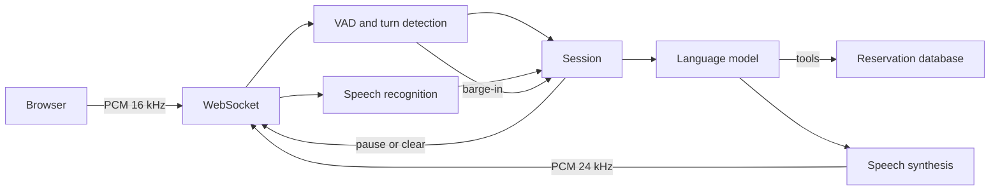

# Real-Time Voice Agent

Restaurant booking voice agent using a browser audio stream, speech recognition, a tool-calling language model, and speech synthesis. The repository contains hosted and GPU self-hosted profiles and a synthetic evaluation harness.

## Architecture



## Quickstart

Install Python 3.12 and [uv](https://docs.astral.sh/uv/), then:

```sh
uv sync --all-groups
cp .env.example .env
# Set DEEPGRAM_API_KEY, OPENAI_API_KEY and CARTESIA_API_KEY in .env.
uv run uvicorn server.app:app --port 8080
```

Open http://localhost:8080 in Chrome and use headphones. The first startup downloads the Silero and Smart Turn models. Never commit `.env`.

## Profiles

| Profile | Description |
|---|---|
| `v1-batch` | Push-to-talk batch pipeline; endpoint wait is effectively zero, flattering its latency. |
| `v2-streaming` | Hosted streaming with ASR endpointing. |
| `v3-hosted` | Hosted streaming with VAD, Smart Turn and interruption handling. |
| `v4-hosted` | Hosted stack with warmup and speculative generation. |
| `v4-selfhosted` | Parakeet, Qwen2.5-7B and Kokoro on a Runpod GPU. |

Select a profile with `VA_PROFILE` and override individual settings with JSON in `VA_OVERRIDES`. The backend stores reservations in SQLite; use separate tenants for independent calls.

## Evaluation

```sh
uv run python -m eval.gen_scenarios
uv run python -m eval.run_eval --profile v3-hosted --concurrency 1
uv run python -m eval.loadtest --profile v4-hosted --levels 1,5,10,20 --scenarios 'simple-*'
uv run python -m eval.sweep_eot --profile v3-hosted --scenarios 'long_pause-*,simple-*'
```

Evaluation calls incur provider charges. Synthetic-caller costs are excluded from agent cost estimates. Results depend on actual provider and GPU runs; no benchmark numbers are claimed before measurement.

<!-- results:start -->
### Headline numbers

v4-hosted: not measured. Run `uv run python -m eval.run_eval --profile v4-hosted`.

### Per-profile results

| Profile | Success | Client v2v p50 | Client v2v p95 | Server v2v p50 | Endpoint wait | ASR finalize | LLM TTFT | Tool | TTS TTFA | Network | False cut-in | WER |
|---|---:|---:|---:|---:|---:|---:|---:|---:|---:|---:|---:|---:|
| v1-batch | not measured | not measured | not measured | not measured | not measured | not measured | not measured | not measured | not measured | not measured | not measured | not measured |
| v2-streaming | not measured | not measured | not measured | not measured | not measured | not measured | not measured | not measured | not measured | not measured | not measured | not measured |
| v3-hosted | not measured | not measured | not measured | not measured | not measured | not measured | not measured | not measured | not measured | not measured | not measured | not measured |
| v4-hosted | not measured | not measured | not measured | not measured | not measured | not measured | not measured | not measured | not measured | not measured | not measured | not measured |
| v4-selfhosted | not measured | not measured | not measured | not measured | not measured | not measured | not measured | not measured | not measured | not measured | not measured | not measured |

Latencies in ms (p50 unless noted). v1-batch uses push-to-talk, so its endpoint wait is ~0, which flatters v1.

### Hosted vs self-hosted (v4)

| | v4-hosted | v4-selfhosted |
|---|---:|---:|
| Task success | not measured | not measured |
| Client v2v p50 (ms) | not measured | not measured |
| Client v2v p95 (ms) | not measured | not measured |
| Barge-in client p50 (ms) | not measured | not measured |
| Cost per 3-min call | not measured | not measured |

### Pipecat baseline

| | Ours (v4-hosted) | Pipecat baseline |
|---|---:|---:|
| Task success | not measured | not measured |
| Client v2v p50 (ms) | not measured | not measured |
| Client v2v p95 (ms) | not measured | not measured |
| False cut-in rate | not measured | not measured |

Server-stage metrics are n/a for the baseline (only client-side metrics are comparable).

### Load test

not measured. Run `uv run python -m eval.loadtest`.

### End-of-turn sweep

not measured. Run `uv run python -m eval.sweep_eot`.
<!-- results:end -->

## Self-hosting

Configure Runpod and self-host API keys in `.env`, then use `uv run python infra/gpu/pod.py --help`. GPU instances incur charges until stopped or terminated. The speech service and vLLM require a GPU.
